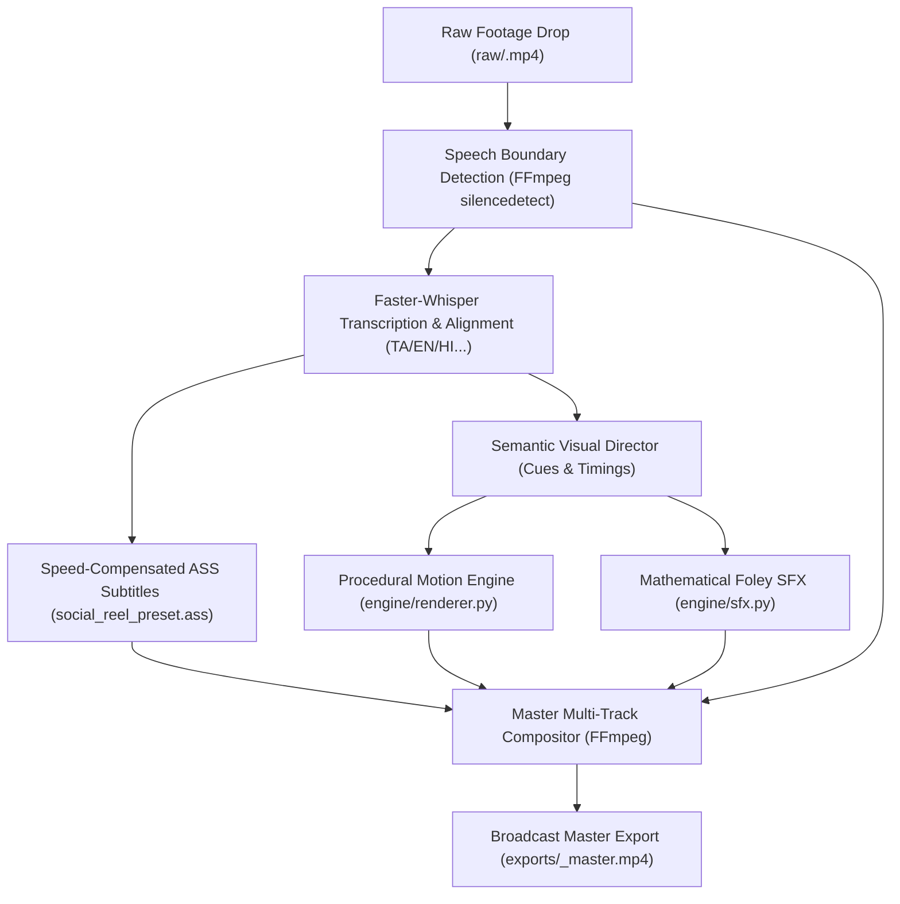

# Generalized Autonomous AI Video Editor: Architecture & Blueprint

## Executive Summary
This document establishes the architecture, workflow, and operations for the **Antigravity Autonomous AI Video Editor Workstation**. It enables the automated transformation of **any raw video footage** (any duration, any language) into a viral, broadcast-quality 9:16 vertical social reel (1080x1920 Full HD @ 30fps) with frame-accurate highlighted subtitles, procedural kinetic motion graphics, and clean studio-mastered audio.

---

## 1. Diagnostics & Root Cause Analysis

### A. The "Extra Audio" (Phantom Voice) Explained
- **Observation**: During playback of `gemini_4_neon_tamil_hybrid_master.mp4`, a faint second voice was audible underneath the primary Tamil narration.
- **Root Cause**: The background music track (`ducked_bgm.wav`) was extracted from the reference reel (`reference/Video-57475.mp4`). That reference video was not pure instrumental music—it contained the original English creator speaking over the music. When ducked to low volume, the English creator was speaking quietly in the background.
- **The Permanent Fix**:
  - In [gemini_4_neon_tamil_clean_audio.mp4](file:///mnt/hdd/Antigravity%20Video%20Editor/exports/gemini_4_neon_tamil_clean_audio.mp4), the contaminated reference track was completely removed.
  - The voice track now undergoes a dedicated vocal mastering chain:
    $$\text{Raw Audio} \xrightarrow{\text{atrim}} \text{Voice Window} \xrightarrow{\text{asetpts}} \xrightarrow{\text{atempo}(S)} \xrightarrow{\text{EBU R128 (-14 LUFS)}} \text{Master}$$
  - Procedural UI Foley sound effects (whooshes, pops, chimes) are synthesized mathematically via [sfx.py](file:///mnt/hdd/Antigravity%20Video%20Editor/engine/sfx.py), eliminating external audio dependencies.

---

### B. Motion Graphics Quality Upgrade
- **Why Earlier Iterations Felt Flat**:
  1. *Jarring Full-Screen Cutaways*: Abrupt cuts away from the speaker to dark 2D static slides or raw third-party UI screencasts broken continuity and felt disjointed.
  2. *Low-Resolution Stolen Screencasts*: Grabbing screen captures from someone else's video caused mismatched language (English text over Tamil speech) and compression artifacts.
  3. *Lack of Dynamic Physics*: Real viral social reels (MrBeast, Vox, Brag) do not use static slides; they use **transparent kinetic overlays** that pop, bounce, and draw themselves directly over the speaker or B-roll.
- **The New Kinetic Engine Solution**:
  - Transparent ProRes 4444 / PNG alpha overlays (`yuva444p10le`) rendered directly over footage.
  - **Procedural Vector Doodles** (`alexgreensh/anidoodle`): Organic hand-drawn circling ovals, kinetic arrows, and animated highlighter underlines that sketch in real time with Bezier jitter.
  - **Dynamic Spring Physics** (`3b1b/manim`): `spring_pop` and `ease_out_back` curves with subtle glow bloom.
  - **Sound-Synced Entrances** (`latent-spaces/brag`): Every visual pop is synchronized with a crisp procedural UI sound effect.

---

## 2. End-to-End Pipeline Architecture



---

## 3. How to Edit Any New Video

### Method 1: Single CLI Command
Drop any raw video into the `raw/` directory and execute:
```bash
python3 pipeline/auto_editor.py --raw raw/my_new_video.mp4
```

#### Command Options:
- `--theme <name>`: Choose visual style:
  - `cyber_neon` (Cyan, Electric Gold, Dark Mesh)
  - `apple_keynote` (Frost Glass, Clean Titanium, Subtle Glow)
  - `vox_editorial` (Bold Yellow, High-Contrast Editorial, Stark Borders)
  - `fintech_emerald` (Emerald Green, Champagne Gold, Institutional)
- `--speed <float>`: Playback speed multiplier (default `1.18x` compresses speech to punchy reel length while preserving 100% of spoken words).
- `--no-overlays`: Produces a clean talking-head master with synchronized ASS subtitles and studio audio without graphic cards.
- `--dry-run`: Runs speech boundary detection, transcription, and scene cue planning without rendering.

---

### Method 2: Autonomous Subagent Delegation
You can instruct Antigravity or invoke the subagent directly at any time:
> *"Edit the new video in `raw/launch_announcement.mp4` with the `cyber_neon` theme."*

The `video-editor` subagent autonomously:
1. Audits the video file (duration, resolution, audio tracks).
2. Executes [auto_editor.py](file:///mnt/hdd/Antigravity%20Video%20Editor/pipeline/auto_editor.py).
3. Verifies export stream health and loudness (-14 LUFS).
4. Delivers the final video link with scene timestamps and metrics.

---

## 4. Reusable Project Assets

| Component | Path | Description |
| :--- | :--- | :--- |
| **Pipeline Runner** | [auto_editor.py](file:///mnt/hdd/Antigravity%20Video%20Editor/pipeline/auto_editor.py) | Master orchestrator for ingestion, transcription, overlays, and export |
| **Speech Analyzer** | [speech_analyzer.py](file:///mnt/hdd/Antigravity%20Video%20Editor/pipeline/speech_analyzer.py) | Silence detection, dead air trimming, faster-whisper transcription |
| **Visual Director** | [visual_director.py](file:///mnt/hdd/Antigravity%20Video%20Editor/pipeline/visual_director.py) | Semantic keyword, benchmark, and entity detection for visual cues |
| **Subtitle Preset** | [social_reel_preset.ass](file:///mnt/hdd/Antigravity%20Video%20Editor/presets/subtitles/social_reel_preset.ass) | 4-tier color hierarchy with 5.5px stroke and vertical safe zones |
| **Subtitle Styler** | [subtitle_styler.py](file:///mnt/hdd/Antigravity%20Video%20Editor/presets/subtitles/subtitle_styler.py) | Speed-compensated timestamp compiler ($T_{\text{new}} = \frac{T_{\text{raw}} - T_0}{S}$) |
| **Motion Engine** | [renderer.py](file:///mnt/hdd/Antigravity%20Video%20Editor/engine/renderer.py) | Transparent alpha-channel (ProRes 4444) motion graphics renderer |
| **Foley SFX Engine** | [sfx.py](file:///mnt/hdd/Antigravity%20Video%20Editor/engine/sfx.py) | Mathematical audio synthesizer (whoosh, pop, chime) |
| **Clean Video Master** | [gemini_4_neon_tamil_clean_audio.mp4](file:///mnt/hdd/Antigravity%20Video%20Editor/exports/gemini_4_neon_tamil_clean_audio.mp4) | Verified export with 100% clean voice master and zero phantom chatter |
